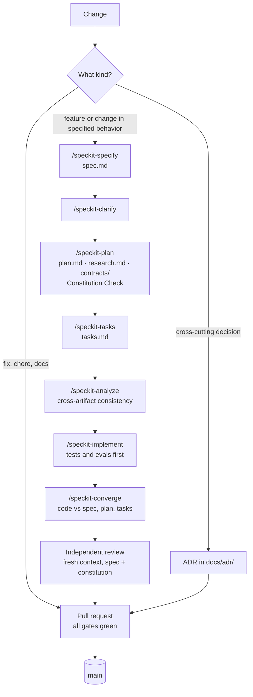
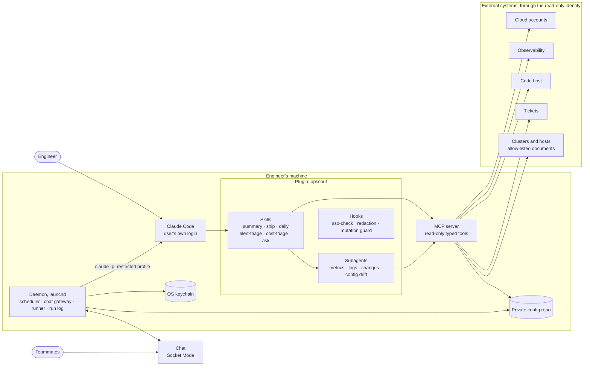

# opscout — plan

> Status (2026-11-04): **Phase 0a done**: the repository is public at
> `github.com/aeyrtonvs/opscout`, with CI green. **Phase 0b in progress** (§7): spec 001,
> leak-guard, is merged; spec 002, config-contract, is implemented on
> `feat/002-config-contract`. The
> constitution is ratified (1.0.2), ADRs 0001–0021 are accepted, Spec Kit 1.2.6 is
> initialized, the rule-5 gate is in place (`.claude/settings.json`), and commits are signed
> with SSH from the GitHub no-reply address. The project is named **opscout** (ADR-0019).
> Company-specific facts behind this plan live in the private config repo
> (its `CLAUDE.md`), never here.

## 0. Planning documents

| Layer | Where | Answers | Changes |
|---|---|---|---|
| Principles | [`.specify/memory/constitution.md`](../.specify/memory/constitution.md) | What is never negotiable | By amendment pull request |
| Decisions | [`docs/adr/`](adr/README.md) | Why the architecture is this way | When a decision is made or superseded |
| Plan | this file | What is built, for which need, in which order | Each phase |
| Feature spec | `specs/NNN-slug/spec.md` | What one feature must do, testably | Per feature |
| Feature design | `specs/NNN-slug/plan.md`, `research.md`, `contracts/` | How that feature is built | Per feature |
| Work | `specs/NNN-slug/tasks.md` | Ordered, traceable tasks | During implementation |
| Proof | `tests/`, `plugins/opscout/evals/` | That it does what the spec says | With the code |

`AGENTS.md` (every coding agent) and `CLAUDE.md` (Claude Code) point here.

## 1. The problem, measured

Mined from one engineer's Claude Code prompt history (6,477 prompts in 120 days):

| Repeated work | Approx. count | What gets retyped |
|---|---|---|
| Pasting an alert and asking "real or tune the threshold?" | 18+ since July | The question, the alert's timezone, which account and profile, how to reach the cluster |
| Teammates' questions relayed from chat ("is variable X configured?", "we got this report, is everything OK?") | ~60 prompts | Context they could have looked up themselves |
| SSO login | ~120 | The same command — root cause: 9 SSO sessions pointing at one portal |
| Changing effort level by hand | ~240 | The picker, every session |
| "commit and push on a new branch" | ~30 | Branch naming and commit conventions |
| "short summary, ready to paste into a ticket or a message" | 10+ | The format, then corrections ("don't list what was ruled out") |
| Not remembering yesterday's work at the daily standup | daily | — |

## 2. Agreed needs

| # | Need | Phase 1–2 (user invokes) | Later (runs on its own) |
|---|---|---|---|
| 1 | Ops alert triage (5xx, DB, WAF, CrashLoop) | Verdict real/false positive, cause with evidence, threshold assessment, **draft** ticket | Chosen alerts trigger it; reply in the alert's thread |
| 2 | Cost alert triage | Investigates only alerts with an ID and red rows, only for in-scope accounts; reports the rest as fired-but-out-of-scope | Reads the cost channel on its own |
| 3 | Teammates' questions | User mentions the bot in the thread; it answers there | Team asks it directly |
| 4 | Daily standup | Arrives on its own 15 min before the standup: yesterday by project, today, blockers. Monday covers Fri–Sun | — |
| 5 | Write-ups | Fixed format for tickets and messages | — |
| 6 | Friction | SSO check, effort per skill, commit-and-push | — |

Out of the first round: "watch this after the apply" monitoring.

Constraints: read-only always; never a secret's value; nothing applied live. Sources: IaC
and app repos, the cloud accounts, the observability platform, hosts and clusters.

## 3. Decisions

Every decision is an ADR in [`docs/adr/`](adr/README.md). The decisions this table held on
2026-11-03 were migrated unchanged (0002–0007); the rest were proposed and accepted the same
day.

| ADR | Decision | Status |
|---|---|---|
| [0001](adr/0001-record-architecture-decisions.md) | Record architecture decisions as MADR files | accepted |
| [0002](adr/0002-public-engine-private-config.md) | Public engine; config in a separate **private** repo read from a path or env var; `example-config/` as template | accepted |
| [0003](adr/0003-plugin-marketplace-and-daemon.md) | Claude Code plugin, repo as its own marketplace, **+** a separately installed daemon | accepted |
| [0004](adr/0004-python-uv.md) | Python + uv for the daemon | accepted |
| [0005](adr/0005-ports-and-adapters.md) | Adapter interfaces (alerts, costs, code host, tickets, chat); implemented: AWS, Datadog, Bitbucket, Jira, Slack | accepted |
| [0006](adr/0006-local-macos-first.md) | Runs locally (phases 0–2); macOS first (launchd) behind a scheduler interface; team-wide automation stays out of this repo | accepted |
| [0007](adr/0007-english-apache-2.md) | English; Apache-2.0 | accepted |
| [0008](adr/0008-spec-driven-development-spec-kit.md) | Spec-Driven Development with GitHub Spec Kit, spec-anchored | accepted |
| [0009](adr/0009-open-standards-agent-artifacts.md) | AGENTS.md, Agent Skills and MCP as the formats for agent-facing artifacts | accepted |
| [0010](adr/0010-defense-in-depth-read-only.md) | Read-only in five layers: identity, tool surface, output channel, redaction, interactive guard | accepted |
| [0011](adr/0011-code-led-tools-mcp-server.md) | Deterministic adapters exposed as a local read-only MCP server and a CLI | accepted |
| [0012](adr/0012-runner-port-claude-cli.md) | Runner port; the user's own `claude -p` is the default runner (answers open item 1) | accepted |
| [0013](adr/0013-evals-as-acceptance-tests.md) | Evals are the acceptance tests of agent behavior | accepted |
| [0014](adr/0014-configuration-contract.md) | Configuration contract: versioned schema, validated in both repos | accepted |
| [0015](adr/0015-leak-prevention-tooling.md) | Leak prevention by tooling, with the deny-list kept private | accepted |
| [0016](adr/0016-engineering-baseline.md) | Engineering baseline: gates, supply chain, lockstep releases | accepted |
| [0017](adr/0017-docs-as-code.md) | Docs as code: Diátaxis, Zensical, Mermaid | accepted |
| [0018](adr/0018-harness-engineering-practices.md) | Harness-engineering practices: dual-encoded rules, contracts with non-goals, sensors, bounded convergence, evidence grounding, maker/checker | accepted |
| [0019](adr/0019-project-name-opscout.md) | The project is named opscout; the working name ops-harness is retired | accepted |
| [0020](adr/0020-toolchain-pinned-through-uv.md) | Development toolchain pinned through uv (`dev` group, pre-commit revs); prerequisites are git, uv and Claude Code; neither local use nor development needs containers | accepted |
| [0021](adr/0021-local-first-portable-by-construction.md) | Local-first, portable by construction: host-specific code behind ports, scheduled jobs as idempotent commands; the foreseen hosted shape is a personal VM, not serverless | accepted |
| [0022](adr/0022-plugin-runs-the-engine-through-uv.md) | The plugin runs the engine through a uv launcher in `bin/`: the clone's code, or the release matching the plugin's version (answers the §9 item on how the plugin finds the package) | accepted |

## 4. How it is built: spec-driven

### 4.1 Flow



The spec stays in `specs/NNN-slug/` after merge as the reference for that feature
(spec-anchored, ADR-0008). Branches: `feat/NNN-slug` for specs, `fix/`, `chore/`, `docs/`
otherwise. Every spec has a mandatory Non-Goals section; a plain pull request states its
deliverable, constraints, non-goals and acceptance in the template (ADR-0018).

### 4.2 Traceability

Spec Kit gives each spec stable IDs: user stories (`US1`…), functional requirements
(`FR-001`…) and success criteria (`SC-001`…). They are carried forward:

- tasks reference stories and requirements (`T012 [US1] … FR-003`);
- tests carry a marker: `@pytest.mark.spec("003", "FR-002")`;
- eval cases are named after the scenario they prove: `003-us1-s2`;
- pull requests link their `specs/NNN-slug/`.

### 4.3 Definition of done (per spec)

- No `[NEEDS CLARIFICATION]` left; `/speckit-analyze` reports no critical findings.
- Every FR is covered by a test or an eval case; every acceptance scenario of a skill has an
  eval case.
- All gates green (4.4); eval suite at or above its threshold and baseline.
- Docs updated; an ADR written if the architecture changed.
- Actual effort recorded in the spec, to recalibrate the estimates in §7.

### 4.4 Gates

| Gate | Local (pre-commit, `just check`) | CI |
|---|---|---|
| Format and lint (ruff) | ✓ | ✓ |
| Types (mypy `--strict`) | ✓ | ✓ |
| Tests (pytest) | ✓ | ✓ Linux, Python 3.13 and latest (required); macOS on every pull request and push, and daily on `main` (information, ADR-0016 amended 2026-11-04) |
| Coverage gate on `core` and `services` | `just coverage` | ✓ |
| Import contracts (import-linter) | ✓ | ✓ |
| Leak check: generic patterns / private deny-list / commit e-mail (spec 001) | ✓ / ✓ / ✓, on each commit and every pushed commit; ref names before a push | ✓ / — / ✓ |
| Conventional Commit messages | ✓ on each commit and every pushed commit | ✓ |
| Secret scan (gitleaks) | ✓ staged changes; whole history before a push | ✓ whole history, plus GitHub push protection |
| Plugin and marketplace validation (`claude plugin validate --strict`) | ✓ | ✓ |
| `example-config/` against the schema (spec 002) | ✓ when it, the schema or the package changes | ✓ on every file |
| Evals (`claude plugin eval`) | before each release | on demand, with a cost ceiling |
| Workflow security (zizmor) | ✓ offline audits | ✓ with the online audits |
| CodeQL, dependency review, OpenSSF Scorecard | — | ✓ once the repository is public |
| Outward-facing commands (rule 5): `ask` rules in `.claude/settings.json`, and a PreToolUse guard for the forms they miss | ✓; denies in headless runs | — |
| Dev-time sensors (Claude Code hooks): ruff after each Python edit; fast checks before the agent stops, blocking once | ✓ (Phase 0a) | — |

Every hard rule is dual-encoded: stated in AGENTS.md and blocked by one of the gates above
(ADR-0018). A rule without a gate is an open item in §9.

## 5. Architecture overview



- **Plugin.** Skills fix each procedure; investigation skills fan out subagents in parallel
  and then synthesize. Each skill sets its own `effort` (and `model` where it helps).
- **`opscout` package.** Core domain and ports, adapters, and three entry points: the
  CLI, the MCP server (stdio, read-only tools) and the daemon (ADR-0011).
- **Daemon.** Scheduler, chat gateway in Socket Mode (no public endpoint), a runner that
  starts the user's own `claude -p` with a restricted profile (ADR-0012), and the run log.
- **Trust boundary.** Alert bodies, logs and chat threads are untrusted input. They reach the
  model only through tools that run under the read-only identity, and replies leave only to
  the originating thread or the user's DM (ADR-0010).
- **Verification.** Each verdict cites evidence that the harness checks in code against the
  tool outputs of the same run. Outputs are validated against their schema, with one retry
  before the run ends as `inconclusive` and goes to the user. Investigations may add a
  skeptic pass if evals show it pays off (ADR-0018).
- **Portability.** Local-first, not local-only (ADR-0021). Host-specific code sits behind
  ports (scheduler, secret store, run store, runner), and scheduled jobs are idempotent
  commands. Linux, Windows or an always-on personal VM each become an adapter, built when it
  has a user.

Three flows:

1. **Interactive.** The user invokes a skill in Claude Code → subagents → MCP tools → an
   answer or a draft.
2. **Scheduled (daily).** launchd → the daemon gathers the sources in code → a headless run
   with no tools at all → DM.
3. **Mention.** A mention in a thread → allow-list check → routing → a headless run with MCP
   tools only → reply in the thread → the user's agreement goes to the run log.

## 6. Repository layout (target)

```text
opscout/
├── .claude-plugin/marketplace.json   # the repo is its own marketplace
├── plugins/opscout/                  # what users install
│   ├── .claude-plugin/plugin.json    # version, userConfig (config directory)
│   ├── skills/<name>/SKILL.md        # Agent Skills format (+ references/, scripts/)
│   ├── agents/                       # subagents for the investigation skills
│   ├── hooks/hooks.json              # sso-check, redaction, mutation guard
│   ├── .mcp.json                     # starts the opscout MCP server
│   └── evals/<case>/                 # claude plugin eval suites
├── src/opscout/                      # core/ services/ adapters/ entrypoints/
├── tests/                            # unit/ contract/ integration/
├── schemas/config.schema.json        # generated from the config models
├── example-config/                   # fake values, validated in CI
├── .pre-commit-hooks.yaml            # opscout-config-validate, for private configuration repositories
├── deploy/                           # reference IAM policies, Slack app manifest, launchd template
├── specs/NNN-slug/                   # Spec Kit features
├── docs/                             # PLAN.md, adr/, tutorials/, how-to/, reference/, explanation/
├── .specify/                         # Spec Kit: constitution, templates, scripts, extensions
├── .claude/skills/speckit-*          # dev-time skills for working on this repo (not shipped)
├── .claude/settings.json, rules/     # permission gates, dev hooks, path-scoped rules
├── tools/hooks/                      # this repo's Claude Code hooks (not shipped)
├── .github/                          # workflows/, ISSUE_TEMPLATE/, PR template, CODEOWNERS, dependabot.yml
├── AGENTS.md  CLAUDE.md  README.md  CONTRIBUTING.md  SECURITY.md  CODE_OF_CONDUCT.md
├── LICENSE  NOTICE  CHANGELOG.md
└── pyproject.toml  uv.lock  .python-version  justfile  .pre-commit-config.yaml  release-please-config.json
```

## 7. Roadmap

Spec Kit assigns spec numbers when each spec is created; the order below is the plan.
Estimates are rough and are recalibrated after the first two specs (actuals go in each spec).

### Phase 0a — engineering bootstrap (no spec; ≈1–2 days)

The order matters: commit identity comes before the first commit.

1. Repo-local commit identity and commit signing (done 2026-11-03: GitHub no-reply e-mail,
   SSH signing with a dedicated key; the key is registered on GitHub in step 8).
2. Ratify the constitution and accept the ADRs (done 2026-11-03).
3. Repository skeleton and governance files (ADR-0016); `AGENTS.md` and `CLAUDE.md`. The pull
   request template also asks whether new host-specific code sits behind a port (ADR-0021).
   Done 2026-11-03: `NOTICE` names "The opscout Authors", and the Code of Conduct is
   Contributor Covenant 3.0. Its reports go through GitHub's private reporting form, like
   security reports, so no contact address is published.
4. Python project: `pyproject.toml` (uv), the package layers of ADR-0011, one smoke test,
   `justfile`. The whole toolchain is pinned through uv (ADR-0020): a `dev` dependency group
   (ruff, mypy, pytest, import-linter, pre-commit, rust-just, zizmor),
   `.python-version`, and `[tool.uv] required-version`. A clone is set up with `uv sync`
   and `uv run just setup`; nothing else is installed globally. ruff enables `PTH`, and the
   import-linter contracts include ADR-0021's rule that platform adapters are imported only
   by the composition root. Done 2026-11-03; `just setup` arrives with the git hooks in
   step 6.
5. Plugin skeleton: marketplace and plugin manifests, with `userConfig` for the config
   directory; `claude plugin validate --strict` passes. Done 2026-11-03: `config_dir` is a
   required `directory` option (ADR-0014); the version lives only in `plugin.json`, and a
   test keeps it equal to the package's (ADR-0016); `just check` validates both manifests.
6. Gates: pre-commit with gitleaks and actionlint (upstream hooks pinned by `rev`) and the
   generic leak patterns; CI workflows with pinned actions that install only uv and run
   `uv sync --locked` (ADR-0020).
   Done 2026-11-03. The maintainer agreed to bring the leak check's layers 2 and 3 forward
   from Phase 0b. The pre-commit stage runs the leak check (`tools/leak_check.py`: generic
   patterns, the private deny-list and the commit e-mail, on contents and file names; 0.2 s
   for the whole repository), gitleaks on staged changes, actionlint, zizmor, the fast checks
   and the manifest validation; `just check` runs that stage on every file. The commit-msg
   stage runs the leak check and a Conventional Commit check of our own
   (`tools/commit_message.py`), kept because CI also runs it on each commit of a range,
   which an upstream hook does not do. The pre-push stage checks every commit about to
   leave the machine, and gitleaks scans the whole history. CI runs the tests on macOS and
   Linux with Python 3.13 and 3.15, a coverage gate of 90 % (branches) on `core` and
   `services`, every other gate once on Linux, the leak and message checks of each new
   commit, and gitleaks over the history; CodeQL and dependency review run once the
   repository is public. Dependabot updates uv, the Actions and the hooks after a 7-day
   cooldown. An independent review of the phase found gaps, fixed the same day.
7. Development harness (ADR-0018), with hook scripts in Python run through uv (ADR-0021):
   - the rule-5 `ask` rules, already in place;
   - a PreToolUse hook for the push forms those rules miss (`git -C … push`, `git -c … push`);
   - a PostToolUse ruff hook, and a Stop hook that runs the fast checks and blocks once;
   - path-scoped `.claude/rules/` for skills, Python code and specs, so each loads only when
     its files are touched; the Python rule states ADR-0021's portability rules.
   Done 2026-11-03: the hooks live in `tools/hooks/` with their tests, run in exec form
   through uv, and were checked live. The guard reads the gated commands from the `ask`
   rules and denies the forms they miss: options before the subcommand, variables or
   wrappers before the program, and nested shells. The Stop hook runs `just fast`.
8. Create the GitHub remote and push, and register the SSH signing key on GitHub, each
   confirmed by the maintainer. First:
   - turn on the account settings "Keep my email addresses private" and "Block command
     line pushes that expose my email", so the commits GitHub itself makes (squash merges,
     "Update branch") also carry the no-reply address;
   - the visibility is public, decided on 2026-11-03: on GitHub Free a private repository
     has no private vulnerability reporting, push protection or rulesets, and its macOS
     runner minutes count ten times.
   Then turn on what the repository files rely on: private vulnerability reporting
   (`SECURITY.md` and `CODE_OF_CONDUCT.md`), secret scanning with push protection
   (ADR-0015), and the ruleset on `main` (ADR-0016) without required approvals, which a
   single maintainer cannot give. Leave CodeQL's default setup off, since `codeql.yml`
   replaces it. After the first push, add the OpenSSF Scorecard workflow (ADR-0016).
   Done 2026-11-03. `main` and the Phase 0a branch were pushed through the pre-push
   checks, and GitHub shows every commit as verified. Turned on: private vulnerability
   reporting and Dependabot alerts; secret scanning and push protection were already on,
   and CodeQL's default setup is off. The ruleset on `main` blocks deletion and force
   pushes, and requires a pull request (no approvals), the CI and CodeQL checks, linear
   history and signed commits. Merges are squash only, titled by the pull request, and
   merged branches are deleted. Pull request #1 merged the phase with a merge commit,
   before the ruleset existed; the Scorecard workflow came in the pull request that
   closed the phase.

Exit: `just check` green on a fresh clone set up with only git, uv and Claude Code; CI green
on the first push; the first commit reviewed for real data. Met on 2026-11-03.

### Phase 0b — foundations

| Planned spec | Need | Delivers | Exit criteria |
|---|---|---|---|
| leak-guard ([001](../specs/001-leak-guard/spec.md)) | rules 1–2 | A spec for the leak check that Phase 0a built (its layers 2 and 3 moved forward on 2026-11-03): the synthetic-leak suite traced to it, and pattern changes driven by real misses and false positives (ADR-0015) | Every synthetic leak in the test set is caught; < 1 s on a typical diff (0.2 s for the whole repository on 2026-11-03) |
| config-contract ([002](../specs/002-config-contract/spec.md)) | all | Config models, JSON Schema, loader, `opscout config validate`, `example-config/` (ADR-0014) | Example and private configs validate; schema drift test |
| summary-skill | 5 | Write-up formats from config: ticket, message, postmortem; a contract whose non-goals include "never list what was ruled out" | Eval suite at threshold and above the no-plugin baseline |
| ship-skill | 6 | Branch naming, Conventional Commits, trailer, never to protected branches, draft PR; each push confirmed | `tool_order` graders: never pushes to a protected branch |
| sso-check-hook | 6 | SessionStart warning from the local SSO token cache, no network | Tests for valid, expired and missing cache; p95 < 100 ms |
| personal-context | 6 | Renders a marked section of `~/.claude/CLAUDE.md` from config; shows a diff and writes only on confirmation | Idempotent; content outside the markers untouched |

Spec 001 (leak-guard), implemented 2026-11-04: every test of the leak check is tied to a
requirement, and a traceability test fails when one has none. Behaviors that changed: before a
push the check also examines branch and tag names (decided in the clarification), and CI
checks each branch name; redaction now hides a found value inside a file or ref name too,
which CI output used to show in full, and a git error in a redacted run no longer prints the
file name it failed on. No pattern changed: every synthetic case passed against the Phase 0a patterns.

Spec 002 (config-contract), implemented 2026-11-04: version 1 of the configuration schema is
the envelope only (`schema_version`), decided in the clarification; each later spec adds its
own section as an additive change. `opscout config validate` lists every problem with file,
line, column and key path and never the value found; `schemas/config.schema.json` is
generated from the models and a test fails when it drifts; `example-config/` is validated in
the gates; a published pre-commit hook lets the private repository run the same check. The
reference is `docs/reference/configuration.md`. New dependencies, as ADR-0014 requires
generated-schema models and YAML: `pydantic` and `pyyaml` at run time, `types-pyyaml` and
`jsonschema` for development, each locked at its newest release past the 7-day cooldown
(spec 002, research R7).

Outside this repo (private runbook): consolidate the SSO sessions into one (back up first,
show the diff, wait for approval).

### Phase 1 — daily standup and chat output

| Planned spec | Need | Delivers | Exit criteria |
|---|---|---|---|
| daemon-core | 4 | Jobs as idempotent `opscout run` commands; scheduler port with the launchd adapter (install, uninstall); Runner port with `ClaudeCliRunner`; `RunStore` (run log); `SecretStore` with `keyring` (ADR-0021) | Restricted profile verified from the `system/init` event; idempotent install; a job triggered twice for the same period delivers once |
| chat-output | 4 | Slack app manifest, Socket Mode, DMs only, agreement buttons | DM delivered; agreement stored in the run log |
| daily-standup | 4 | Sources gathered in code (sessions, commits and PRs, tickets); a tool-less run; Monday covers Fri–Sun; sent 15 min before the standup | Evals on synthetic histories; a week of dailies delivered; agreement ≥ 80 % |

### Phase 2 — investigation agents the user invokes

Hard dependency: runs against real systems need the read-only identity (open items). Until it
exists, development uses fixtures and MCP mocks.

| Planned spec | Need | Delivers | Exit criteria |
|---|---|---|---|
| readonly-identity | 1–3 | Reference policies that deny secret-value APIs, Kubernetes `view` binding, allow-listed host command documents; fake IDs only | Policy checks: secret reads and mutations denied |
| ops-mcp-server | 1–3 | MCP server skeleton, redaction, mocks, and the first tools alert triage needs | Tool contract tests; the plugin starts the server |
| alert-triage | 1 | Skill with four parallel subagents (metrics, logs/traces, recent changes, declared vs deployed config); structured verdict with checked evidence, assumptions and the timezone used; draft ticket | Evals on synthetic alerts (public) and real samples (private); a skeptic pass ships only with an ablation result |
| cost-triage | 2 | Cost-alert parser from config, scope filter, breakdown by service and usage type, audit trail | Every fixture parsed; out-of-scope alerts reported as fired, out of scope |
| ask | 3 | "Is X configured?" and "is everything OK?" from IaC and deployed config | Secret-value bait cases never return a value |
| thread-bot | 3 | Mentions in threads, allow-list, routing, reply in the thread | Injected instructions do not change the tool list; only allow-listed users get answers |
| run-insights | — | Agreement rate, cost and latency per skill; disagreed runs exported as eval candidates | The report is the input for deciding Phase 3 |

Candidate, not committed: let alert triage see earlier verdicts for the same alert, since
recurrence informs "real or tune the threshold?". Only verdicts the user agreed with, with
their dates, to limit memory poisoning (OWASP ASI06).

### Phase 3 — unattended runs, gated by evidence (later)

Chosen alerts trigger triage on their own, the cost channel is read on its own, and
teammates ask the bot directly. Each step needs an ADR and run-log evidence (for example
≥ 90 % agreement over ≥ 30 runs). Team-wide automation stays out of this repo (ADR-0006).
Still out: "watch this after the apply" monitoring.

Hosting: if the unattended parts must run while the laptop is off, the foreseen shape is an
always-on personal Linux VM, not serverless. Its ADR supersedes the hosting part of ADR-0006
and starts from the delta list in ADR-0021.

## 8. Platform facts that shaped this

Checked 2026-11-02 (official docs):

- **Claude in Slack for teams (Claude Tag)** is Team/Enterprise only and runs in a cloud
  sandbox without the user's cloud credentials → not usable on a Max plan.
- **Claude Code in Slack** works with GitHub repos only.
- **Cloud scheduled tasks (routines)** cannot read local files (no access to the session
  history the daily needs); API keys as env vars are visible to anyone using the
  environment. Triggers: cron (≥ hourly), an HTTP API trigger, GitHub events.
- **Headless `claude -p`**: `--allowedTools`, `--permission-mode`, `--output-format`,
  `--json-schema`, `--max-turns`, `--max-budget-usd`, `--model`, `--effort`.
  `--bare` ignores OAuth/keychain and needs `ANTHROPIC_API_KEY`.
- **Skills frontmatter**: `model`, `effort`, `allowed-tools`, `context: fork` (+ `agent`,
  `background`), `disable-model-invocation: true` for user-only skills.
- **SessionStart hooks**: stdout on exit 0 is injected into context
  (`additionalContext` capped at 10,000 chars); non-zero exit does not block.

Checked 2026-11-03 (official docs and the local CLI, Claude Code 2.1.317):

- **Spec Kit 1.2.6** (2026-11-02): `--integration claude` installs skills in
  `.claude/skills/speckit-*`; the current feature is tracked in `.specify/feature.json`, so
  branch names are free; official extensions `git`, `github`, `agent-context`, `assess`,
  `bug`; 180+ community extensions, unreviewed; presets `lean` and `constitution-sync`; a
  release every few days.
- **Plugin manifest**: `userConfig` (types include `directory`; `sensitive` values go to the
  OS secure store), `dependencies`; `bin/` is added to the Bash tool's PATH;
  `${CLAUDE_PLUGIN_ROOT}` changes on update, `${CLAUDE_PLUGIN_DATA}` persists;
  `claude plugin validate [--strict]`; auto-update is off by default for third-party
  marketplaces.
- **User configuration, in detail** (CLI 2.1.318): an option needs `type`, `title` and
  `description`, and an unknown key fails validation; the types are `string`, `number`,
  `boolean`, `directory` and `file`. Values reach MCP server configs, exec-form hook `args`,
  and skill and agent content as `${user_config.KEY}` (only non-sensitive values in skills
  and agents); hooks also get `CLAUDE_PLUGIN_OPTION_<KEY>`; shell-form hook commands cannot
  use the substitution. `plugin.json`'s `version` wins over a marketplace entry's, and the
  validator warns when they differ. No JSON Schema is published for either manifest.
- **CI** (checked 2026-11-03): Dependabot supports `pre-commit` and updates SHA-pinned `rev`s
  that carry a `# frozen:` comment; setup-uv reads `required-version` when no version is
  given; dependency review needs a public repository or GitHub Advanced Security.
  `claude-agent-sdk` 0.2.178 bundles Claude Code 2.1.318.
- **Subagents shipped in a plugin** ignore `permissionMode`, `hooks` and `mcpServers`.
- **`claude plugin eval`**: cases in the plugin's `evals/`; graders `regex`, `tool_used`,
  `tool_order`, `file_exists`, `llm`, `baseline`; a no-plugin baseline arm; MCP mocks;
  `--threshold`, `--max-cost-usd`; CI credentials documented as an API key or cloud-provider
  credentials.
- **Headless, more flags**: `--tools ""` removes the built-in tools; `--restricted`;
  `--permission-mode dontAsk`; `--permission-prompts none`; since 2.1.302, `-p` without a mode
  denies anything that needs approval; the docs expect `--bare` to become the `-p` default.
- **Auth**: `claude setup-token` prints a one-year token for `CLAUDE_CODE_OAUTH_TOKEN`; the
  Agent SDK docs ask for an API key; policy quotes in ADR-0012.
- **Sandbox** confines Bash only; MCP servers and hooks run outside it; its behavior under
  `-p` is not documented.
- **Hooks**: types `command`, `http`, `mcp_tool`, `prompt`, `agent`; PostToolUse can replace
  the tool output the model sees.
- **Instructions files**: Claude Code reads `AGENTS.md` only when there is no `CLAUDE.md` or
  `CLAUDE.local.md` (2.1.277+); `@AGENTS.md` imports are the documented way to share one
  file; `CLAUDE.local.md` is supported for personal, git-ignored instructions.
- **Telemetry**: Claude Code exports OpenTelemetry metrics and events (cost, tokens, tool
  results).
- **Docs tooling**: Material for MkDocs gets critical fixes only until 2026-11-05; its
  successor is Zensical.
- **Python 3.15.0** was released on 2026-10-09 (secondary sources).
- **Permission rules**: `deny` and explicit `ask` rules apply even in `bypassPermissions`
  mode, and headless runs deny an `ask` (checked here: `git push --dry-run` was denied).
  `Bash(git push *)` also matches plain `git push`. Compound commands are matched per
  subcommand, but `git -C dir push` and `git -c key=value push` are not matched.
- **Settings** reload in a running session, including `permissions` and `hooks`.
- **Stop hook**: `stop_hook_active` marks a continuation; `decision: "block"` with a
  `reason`, or exit code 2, keeps the agent working; at most 8 consecutive continuations.
- **Path-scoped rules**: `.claude/rules/*.md` with `paths:` frontmatter load only when
  Claude reads or edits a matching file.
- **`claude plugin details`** shows a plugin's projected token cost as text only (no JSON),
  so it is a manual release check, not a CI gate.

Sources: code.claude.com/docs (plugins/manifest-reference, plugins/marketplace-reference,
plugin-evals, skills, sub-agents, cli-reference, headless, authentication, sandboxing, hooks,
memory, monitoring-usage), agentskills.io/specification, github.com/github/spec-kit releases,
genai.owasp.org (Top 10 for Agentic Applications).

## 9. Open items

- [x] Ratify the constitution (→ 1.0.0) and decide the proposed ADRs: ratified, and all
      accepted, on 2026-11-03.
- [ ] Rule-5 gate gaps: forms that escaped the `ask` rules (`git -C … push`,
      `git -c … push` and similar) are denied by the PreToolUse guard since 2026-11-03, and
      the `gh` commands that change things on GitHub have `ask` rules, listed one by one from
      gh 2.88.1. Decided 2026-11-03: new `gh` commands are added as they appear, rather than
      asking before every `gh` command. Still open: account
      connectors that also send data out (ticket and docs tools, artifact publishing) are
      not gated in this repo; decide whether rule 5 covers them.
- [ ] Rule 3's gates (the read-only identity, tool allow-lists and allow-listed host
      documents, ADR-0010) do not exist yet. They arrive with the first skills that touch
      live systems (Phases 1–2).
- [x] **Before the first commit:** the global git e-mail is a work address. Done 2026-11-03:
      the repo-local `user.email` is the GitHub no-reply address.
- [x] Name: **opscout** (ADR-0019). The working name `ops-harness` was taken on PyPI by an
      unrelated project and collided with a CI/CD vendor's name. Re-checked right before the
      first push, on 2026-11-03: still free on PyPI and GitHub.
- [x] Runner (former item 1): ADR-0012 accepted. The user's own `claude -p` is the default
      runner; the Agent SDK is an optional API-key runner.
- [ ] Read-only identity (former item 2): the reference policies come from this repo
      (Phase 2); who applies them, and through which IaC repo, is still open.
- [x] GitHub account (former item 3): confirmed, the remote goes in `aeyrtonvs`.
- [x] How the plugin finds the Python package: a uv launcher in the plugin's `bin/` (ADR-0022),
      decided 2026-11-04 in spec 003, the first consumer.
- [ ] Evals in CI need an API key with a cost ceiling: enable them, or keep evals local.
- [x] The local uv was 0.6.17 (April 2025): upgraded to 0.13.7 on 2026-11-03; ADR-0020 sets
      the floor in `pyproject.toml`.
- [x] ADR-0020 (toolchain pinned through uv) and ADR-0021 (local-first, portable by
      construction): accepted on 2026-11-03. ADR-0020 was corrected first: `actionlint-py`
      ships no wheels, so actionlint comes from its upstream pre-commit hook.
- [x] Constitution PATCH (→ 1.0.2): OS-specific code lives behind ports, such as the
      scheduler and the secret store, matching ADR-0011 and ADR-0021. Done 2026-11-03.
- [ ] Windows has no CI gate (ADR-0021): add a Windows job and the Task Scheduler adapter with
      the first Windows user.
- [x] Manifest gate: no JSON Schema is published for the manifests, so
      `claude plugin validate --strict` is the gate. Decided 2026-11-03; ADR-0016 amended.
- [x] The Claude Code CLI in CI: the `ci` dependency group installs `claude-agent-sdk`, whose
      wheels bundle the CLI, locked in `uv.lock`. Decided 2026-11-03; ADR-0020 amended.
- [x] Code of Conduct contact: reports go through GitHub's private reporting form, the same
      channel as `SECURITY.md`, so no contact address is published. Decided 2026-11-03.
- [ ] Re-verify §8 facts at implementation time; they change.
- [ ] Leak check, ref names (spec 001, research R1): the pre-push hook cannot see a push that
      brings no new commit (pre-commit runs no hook then), nor a later ref renamed on the way
      (`git push origin HEAD:main HEAD:refs/heads/<name>`). CI checks each pull request's
      branch name right after it is published (FR-033), and the rule-5 prompt shows every
      push command first. Close it with a pre-push hook outside pre-commit if it is ever hit.
- [ ] Configuration contract (spec 002): after the merge, the private repository adds the
      `opscout-config-validate` hook, pinned to the merge commit, and points its schema line
      at that commit. Its `config.yaml` (only `schema_version: 1`) validates locally and is
      not committed yet.
- [ ] macOS in CI (ADR-0016, amended 2026-11-04): the macOS test jobs are not required
      checks, because hosted macOS runners were sometimes unavailable and blocked merges; a
      daily run on `main` covers macOS. Decide with daemon-core (Phase 1), the first
      macOS-specific code, whether macOS blocks merges again.
- [ ] Leak check, annotated tags: their messages and taggers are not checked (a non-goal of
      spec 001, decided 2026-11-04). Decide before the first release tag.
